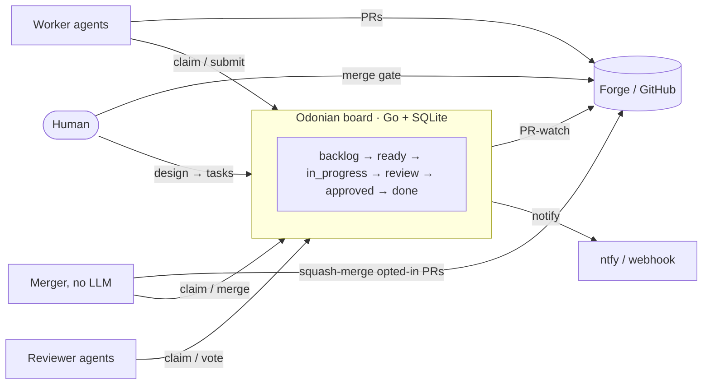

<p align="center">
  <picture>
    <source media="(prefers-color-scheme: dark)" srcset="docs/assets/logo-dark.svg">
    
  </picture>
</p>

# Odonian

[](https://github.com/boldfield/odonian/actions/workflows/ci.yml)
[](./LICENSE)

**Let agents pull the work. Keep control of what lands.**

Odonian is a self-hosted control plane for agent work across your repositories: software builds,
design documents, and source-backed research. A human decomposes the work into bounded tasks on a
per-project board. Workers claim tasks, produce the result, and submit it to configured reviewers.
Human approval before merge is the default; automatic merging is a per-task opt-in
(`agent_merge=true`). Forge branch protection and token scopes enforce who can reach `main`.
A review-approved no-op with no PR completes without a merge or a separate human approval.

It is the control plane only: a work queue with a precise state machine, atomic claiming,
lease-based crash recovery, review routing with a circuit breaker, and a set of level-triggered
reconcilers, behind a REST API and one server/CLI binary. An optional terminal UI lets people
inspect and operate the board; the fleet works through the API.

Two convictions shape the design:

- **Work is claimed, not assigned.** Agents volunteer for tasks they can do; the substrate only
  guarantees that claiming is atomic and that dependencies are honored. There is no scheduler
  handing out orders.
- **The machines labor; a human makes the living judgment.** Agents write and review every line,
  but the default path to `main` runs through a person. The gate is a state in the machine, not a
  sentence in a prompt.



> **Why "Odonian"?** From Ursula K. Le Guin's *The Dispossessed*: the Odonians of Anarres
> organize work through voluntary association — postings that workers claim because the work is
> worth doing, with no boss dispatching them. That is this system's pull model.

## Status

The author has operated Odonian since June 2026, including using it to develop this repository.
The public evidence is narrower than that operational report: as of **2026-11-03**, **423** PRs
had merged here; **302** had a head branch beginning with `mr/`, the fleet's deterministic naming
convention. That is **71%**, rounded down as in [`site/evidence.sh`](./site/evidence.sh). Branch
names alone do not prove which model reviewed a change or who merged it.

This overview was checked against source commit `b3da896`, tagged
[`v0.24.0`](https://github.com/boldfield/odonian/tree/v0.24.0). Tags identify source snapshots,
not the version running in any deployment. See [release and deployment](./docs/running.md#release-and-deployment)
for how images are built and rolled out. CI runs on pull requests and pushes to `main`; its checks
include Go tests and container smoke checks.

It is a personal-scale substrate and wears that honestly. Known limits, in the order they would
hurt at larger scale:

- **Single replica; SQLite in WAL mode on one persistent volume.** No HA, no replication. Backup
  is whatever the volume layer provides.
- **One bearer token; no multi-tenancy.** Everyone with the token is the same principal.
- **No metrics endpoint.** Observability is structured logs, the notifier, and optional authenticated
  [Go profiling](./docs/configuration.md#runtime-profiling-with-pprof).
- **Recovery still depends on leases.** The harness renews owned task leases in the background and
  can hand back claims after recognized backend failures. A hard crash can still leave work waiting
  for expiry; custom clients must manage their own heartbeats.
- **Board-stall detection is specced from an incident and not yet built.** See
  [What broke](#what-broke).

## How it works

### The model

**Projects → Documents → Tasks.**

- A **project** maps to one repository.
- A **document** is a `design` (one per project) or a `feature_spec`. It lives in the repo;
  Odonian stores the ref and an optional commit pin, never the content.
- A **task** is a unit of work decomposed from a document: a spec, a pinned model, the models that
  must review it, its dependencies, a `kind`, and a work `track`.

Submission links include `pr`, `branch`, `commit`, `ci`, and `no_op`; research and continuation
lineage also use server-generated link types. Links support reverse lookup. In pull-request delivery,
`mr/<first eight characters of task id>` identifies the branch, so attempts and rework reuse the
same branch and PR. Local delivery has its own [worktree and landing workflow](./docs/running.md#delivery-modes).

### Work tracks

| Track | Worker output | Review and recovery |
|---|---|---|
| `build` | Code, tests and other repository changes | Configured reviewers must approve; repeated rejection can escalate along the build ladder. |
| `design` | A design document with the required contract headings | Uses its design prompt and the build/design review and escalation rules. |
| `research` | Claims checked against primary sources and an evidence record | Structured findings decide acceptance; finding-scoped disputes, follow-ups and a chain-wide rejection budget govern recovery. |

Tracks select the prompt and review rules; they are separate from task kinds. The bundled harness
supports all three tracks with `pull_request` delivery and only `build` with `local_commit`.
Research escalation is off unless a research ladder is configured. Its rejection budget can require
decomposition even when escalation is enabled. See the [research guide](./docs/research.md).

Reviewed research tasks can opt in to continuation manifests that create bounded follow-up work
when the parent moves from `approved` to `done`. Research admission pacing is optional and **disabled by default**;
in `enforce` mode it reserves capacity and limits starts by account pool. `observe` records policy decisions without denying starts. Isolated reviewer-evaluation
campaigns compare candidate results against frozen inputs; they do not vote on production tasks or
automatically change reviewer assignments. Details are in the [documentation index](./docs/README.md).

### Claiming

At its core, a claim is one conditional `UPDATE`. A simplified eligibility predicate is:

```sql
(state = 'ready' OR (state = 'in_progress' AND lease_expires_at < now))  -- ready, or a dead lease
AND held = 0                                                             -- not pinned by an operator
AND NOT EXISTS (dependency whose state != 'done')                        -- every dependency landed
```

SQLite serializes writers, so exactly one of N concurrent claimers sees `rows affected = 1`. The
rest see `0` and are told why: not found, model mismatch, or plain conflict. The claim, its lease,
and its audit event commit in the same transaction. Leases are checked lazily inside the predicate:
a crashed agent's task becomes claimable the moment its lease lapses, with no sweeper and no reaper
race. Model matching and additional research admission/attempt rules also apply; the SQL above is
not the full contract. See [claiming and leases](./docs/api.md#concurrency--leases).

The harness chooses eligible work across allowed projects by priority descending, creation time
ascending, then task ID ascending. Topic priority is inherited by the tasks the server spawns from it, including reviews,
merges, adjudications and continuations.
Moving a topic to the front affects future dispatch; it neither interrupts running work nor bypasses
holds, dependencies, model availability or admission limits. See [operations](./docs/operations.md).

### States

| State | Meaning |
|---|---|
| `backlog` | Created, not yet claimable. A human promotes it. |
| `ready` | Claimable, subject to dependencies, hold, and model. |
| `in_progress` | Claimed and leased. |
| `review` | Submitted. One review task per required reviewer model is in flight. |
| `approved` | Passed the track's review rules. Awaits landing or the merge gate. |
| `blocked` | Circuit breaker or operator. Unblocking returns it to `ready` with a cleared lease. The review round is not reset yet, so a re-rejection re-trips the breaker; a fix is specced in `docs/specs/`. |
| `done` | Completed: merged, landed locally, or review-verified as a no-op. Terminal. |
| `failed`, `abandoned` | Terminal off-ramps: retired by an operator, or PR closed unmerged. `failed` is absorbing; there is no revive. |
| `superseded` | Terminal. A replacement carries the original assignment plus prior rejection feedback (build/design) or unresolved findings (research). Dependents are re-pointed at it; stale-PR cleanup is best effort. |

Transitions are enforced in the store. Claims, submissions, review aggregation and PR-watch use
store transition logic; operator transitions follow the whitelist in `TransitionTask` ([`internal/store/store.go`](./internal/store/store.go)).

### Kinds, review, and the circuit breaker

- **`implement`**: the work. Pinned to a model, carries a spec, names its reviewer models. On
  submit, one `review` task is spawned per reviewer model.
- **`review`**: auto-created, points at its parent, carries a verdict when submitted.
- **`merge`**: auto-created when an `implement` task with `agent_merge=true` and an active PR is approved. A
  non-LLM merger squash-merges through the forge API. Its lifecycle is
  `ready → in_progress → done` with no review step.

Build/design review requires all configured reviewers to approve. Once the review round finishes,
a rejection returns the parent for rework unless escalation or the circuit breaker intervenes.
Research instead aggregates structured blocking findings; adjudication rules on a disputed finding
and never adds a vote to the round.
On rework, the worker must address every unaddressed review item on the PR, inline threads and
top-level comments alike: enumerate them with `odonian pr-feedback list`, acknowledge each with
`odonian pr-feedback ack` (a marker-stamped reply naming the exact comment/thread and a fixing
commit, plus thread resolution for inline items — a reaction alone never acknowledges a global
comment), and only then can `odonian submit` succeed. It refuses while any item remains, and it
refuses if the task or feedback lookup itself fails rather than treating an unsuccessful lookup as
zero outstanding items — that failure is retryable, so retry the submit once the lookup succeeds,
or pass `--skip-feedback-gate` for an explicit human/emergency bypass. That gate is mechanical,
in the CLI, not an instruction in a prompt. Past a per-model round threshold the **circuit breaker** fires: if
escalation is enabled for the task and a higher tier exists, the task is superseded by a copy pinned
to the next model on the configured build/design ladder and promoted straight to `ready`;
otherwise it goes to `blocked` and a human is notified. With the default allowlist the ladder is
`haiku → sonnet → opus`. If the ladder is unset, it copies the **entire model allowlist in order**;
configure it explicitly when reviewer-only models should not become implementation targets.

Reviewer and worker need not share a vendor. Models listed in `AGENT_CODEX_MODELS` run through
Codex; other model names route through Claude. Reviewer identity, the model allowlist and the
escalation ladder are separate configuration choices. Model names in examples are not a promise
that a provider account has access to them.

### The merge gate

For work that needs to land, `agent_merge=false` (the default) leaves an approved task waiting. The human either records a verdict
with `odonian approve` / `odonian reject`, or acts on GitHub and lets the **PR-watch reconciler**
converge the board: merged → `done`; closed unmerged → `abandoned`; "changes requested" newer than
the approval → back to `ready`, with a marker comment on the PR. With `agent_merge=true` the merger
does the squash-merge after reviewer approval, with no human step.

A current-round `no_op` submission with no active PR link goes directly from review to `done`
after passing review, regardless of `agent_merge`: there is no new change to merge. In
`local_commit` delivery, `odonian approve` performs the protected local landing flow instead of
a forge merge. PR-watch currently follows **approved, human-gated** tasks; it is not a general
reconciler for every task state.

## Operating it

### Topology

- **Server**: one pod from a distroless static image, SQLite on a persistent volume, behind an
  ingress. `replicas: 1` with a `Recreate` strategy, because SQLite is single-writer. This repo
  builds and pushes the image; the manifests are a kustomization with a namespace, PVC,
  deployment, and service in your own infrastructure repo.
- **Fleet**: its own namespace, one Deployment per kind. Workers and reviewers run a heavier
  image (Claude CLI, Codex CLI, Go/Rust/Python/C toolchains, `git`, `gh`, the harness). The
  merger is a small multi-arch image with no LLM in it, so it runs on the cheapest nodes
  (Raspberry Pis, in the reference deployment). Build inputs are in
  [`deploy/fleet/`](./deploy/fleet/README.md).
- **Interface**: the fleet never touches the database. Everything goes through the REST API via
  the `odonian` CLI. The practical capacity limit is vendor rate limits, not nodes.

### One binary

`odonian` is both server and CLI. Run `odonian --help` for the current command list; the
[agent runbook](./AGENT-API.md) explains claiming, submission, priority, research permits and
isolated evaluation, and the [API reference](./docs/api.md) covers operations without a CLI wrapper.

The optional `odonian-tui` shows the board by state with search, filtering, topic priority,
reviewer scorecards and confirm-gated archive actions. Four [interactive skills](./docs/skills.md)
cover task decomposition, board inspection, operations and the human merge gate.

### Reconcilers

Server reconciliation uses **level-triggered reconcilers** on one runner. Each tick reads
current state and acts on it. Nothing keeps a cursor, so a restart mid-tick loses nothing and a
missed tick is caught by the next one.

- **Notifier**: POSTs to a webhook for tasks that need a human (`approved`, `blocked`, and
  recently `failed`). A no-op when no URL is configured.
- **PR-watch**: for approved, human-gated tasks with a PR link, fetches PR state and review
  decisions from GitHub and applies the transitions under [The merge gate](#the-merge-gate).
  It also retries stale-PR cleanup for superseded/abandoned tasks and respects per-owner GitHub
  quota backoff. Comments carry a marker so they are not mistaken for review feedback.
- **Event pruning** at startup: audit events for terminal tasks are trimmed by a retention window.
  Events for live tasks and research-track tasks are retained.

### Failure modes

| Failure | What happens |
|---|---|
| Worker crashes mid-task | Lease lapses; any worker of that model can claim it. The rework lands on the same deterministic branch. |
| Worker finds the work already on `main` | Submits a `no_op` link and no PR; passing review completes the task without a merge. |
| Reviewer rejects repeatedly | Build/design can escalate or block. Research has separate rules and a chain-wide budget that blocks for decomposition. |
| Human requests changes on GitHub after approval | PR-watch bounces the task to `ready` and posts a marker comment; the worker must ack every open item before resubmitting. |
| PR merged or closed outside the board | PR-watch converges: approved tasks to `done` (merged) or `abandoned` (closed); other states to `done` if PR merged, leaving open or closed PRs alone. |
| Server restarts | Reconcilers re-derive from state. Writers wait on SQLite's 5s busy timeout instead of failing fast. |
| Webhook endpoint down | Logged. Level-triggered, so the next tick resends. |
| Forge token missing for an owner | PR-watch skips that owner's repositories, including public ones, and logs when the skipped count changes. Configure the server's per-owner token to resume convergence. |
| A backend fails during dispatch | Known failures trigger account/model backoff and owner-fenced claim handback; other eligible work can proceed. |
| A task is wedged | Hold it via the API/TUI; supersede an abandoned approach and revise the replacement spec if needed, or use an allowed operator transition. See the operations guide. |

### What broke

On 2026-07-09 the review queue deadlocked, and nothing alerted for ten days.

The trigger was a revoked Codex refresh token: every `gpt-5.5` review dispatch failed. The
amplifier was the harness peeking at the queue head without claiming it, so the doomed task stayed
`ready` and stayed the head. Four reviewer pods re-dispatched it roughly 3,100 times each. An
`opus` review three minutes behind it in the queue was unreachable the whole time, and every
implement task dependency-blocked behind those reviews saw a healthy-looking "no claimable work".
Nothing entered `blocked` or `failed`, so the notifier had nothing to report: a fully deadlocked
board was byte-for-byte indistinguishable from an idle one.

What changed: Codex auth got `make` targets and documentation of its refresh-token rotation, and
the detection gap got a written spec with the correct signal. The obvious signal, age of the oldest
claimable task, false-positives: a task whose dependencies cleared this morning looks ten days
stale. The correct signal is board-level: claimable work exists **and** no non-terminal task has
changed within the threshold window. The board-stall reconciler is still unbuilt. The harness now
skips known failing models/accounts and deferred candidates, mitigating the old head-of-line failure;
research work is preclaimed before dispatch, while legacy work still claims inside the model session.
Postmortem and spec:
[`docs/specs/2026-07-20-stall-detection.md`](./docs/specs/2026-07-20-stall-detection.md).

An October 2026 incident exposed a different gap: backend limits left claimed research work
orphaned until lease expiry, while model-local backoff missed aliases sharing an account. The
harness now hands back owned claims on recognized dispatch failure and distinguishes account-wide
rate/sign-in failures from model-specific failures. These mitigations do not replace board-level
stall detection. See [dispatch failure handling](./docs/features/dispatch-failure-handling.md)
and the [operations guide](./docs/operations.md).

### Trust model

- An agent holds three secrets: the board's bearer token, a subscription token for its model
  vendor, and a per-owner forge token. It works in its own detached git worktree.
- `claude -p` runs with permission prompts disabled and Codex runs with
  `--sandbox danger-full-access`. That is why agents run in disposable containers or an `sbx`
  sandbox, never on a workstation that holds other credentials.
- The shared board token grants access across every project and task; there are no per-agent or
  per-project permissions. A worktree separates working directories but does not restrict an
  agent's access to other files, branches, or API operations.
- Forge access is bounded by token permissions and branch protection, including who can bypass
  it. Protect `main` and scope fleet credentials to the repositories and operations they need.
  `agent_merge` controls the board's workflow; it does not revoke an agent's forge permissions.
- The server, fleet, and merger each read forge credentials where they run. Tokens are kept in
  per-owner files and the fleet exports the selected token to its agent; they are never stored
  in the board database or returned by the API. Worker/reviewer operations can fall back to
  local `gh` authentication. The merger requires a matching token in its own `FORGE_TOKENS`
  file (default `~/.odonian/forge-tokens`) and does not fall back to `gh` or `GH_TOKEN`.
- The fleet shares one GitHub identity with its human. Agents self-identify in PR comments with
  `<model>-<role>:` markers (`haiku-worker:`, `opus-reviewer:`, `odonian-reconciler:`); that
  convention is how the tooling tells agent comments from human ones. See
  [`docs/specs/2026-08-18-pr-feedback-single-identity.md`](./docs/specs/2026-08-18-pr-feedback-single-identity.md).

## Quickstart

```bash
make build
export ODONIAN_TOKEN="your-secret-token"
./bin/odonian server            # REST API on :8080, SQLite at ./odonian.db, created on first run
```

Create a project, register a design doc, and post tasks through the [API](./docs/api.md), or let
the `odonian-breakdown` skill do it conversationally. Then point the fleet at the board, one agent
per terminal, in a disposable sandbox or container with authenticated agent and GitHub CLIs.
From the Odonian checkout in each fleet terminal:

```bash
export PATH="$PWD/bin:$PATH"
export ODONIAN_URL=http://localhost:8080 ODONIAN_TOKEN="your-secret-token"
export ODONIAN_PROJECT="full-project-uuid" ODONIAN_REPO="/absolute/path/to/project-repo"
cd harness
./worker.sh worker-1
./reviewer.sh reviewer-1
```

Run one wrapper per terminal. Set the URL to an address reachable from the fleet environment;
`localhost` works when the server runs in that same environment. The
[running guide](./docs/running.md#the-fleet-in-your-development-environment) covers persistent
configuration and the separate server token file needed by PR-watch.

For a self-contained throwaway demo inside an `sbx` sandbox, `bash harness/sbx.sh` (the demo is
the default in `local_commit` mode; `--seed-demo` makes it explicit) boots the server and a small fleet with all state under `/tmp/odonian`, posts one example task,
and leaves it waiting for your approval once a worker and a reviewer have handled it. The
walkthrough, with prerequisites, expected output, the approval step, and cleanup, is
[`docs/demo.md`](./docs/demo.md). The full build, server, TUI, fleet, sandbox, and deployment
reference is in [`docs/running.md`](./docs/running.md).

## Documentation

Start with the [documentation index](./docs/README.md). The main entry points are:

- [First-run demo](./docs/demo.md) and [running guide](./docs/running.md).
- [Research workflows](./docs/research.md) and [queue/recovery operations](./docs/operations.md).
- [Configuration](./docs/configuration.md), [API reference](./docs/api.md), and [agent runbook](./AGENT-API.md).
- [Fleet harness](./harness/README.md), [reference Kubernetes deployment](./deploy/fleet/README.md), and [interactive skills](./docs/skills.md).
- [Dated-spec status index](./docs/specs/README.md), [feature designs](./docs/features/), and the historical [MVP design](./DESIGN.md).

## License

[AGPL-3.0](./LICENSE). Run it, fork it, host it; if you host a modified Odonian for others, share
your changes.
